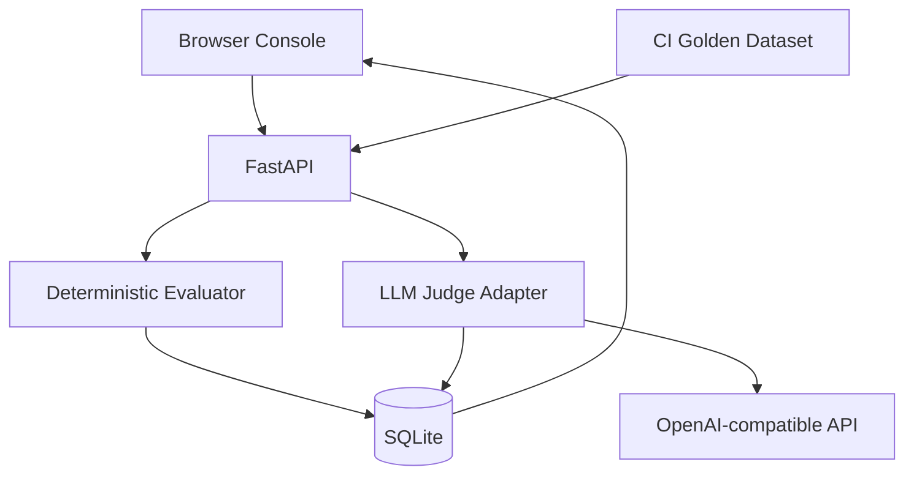
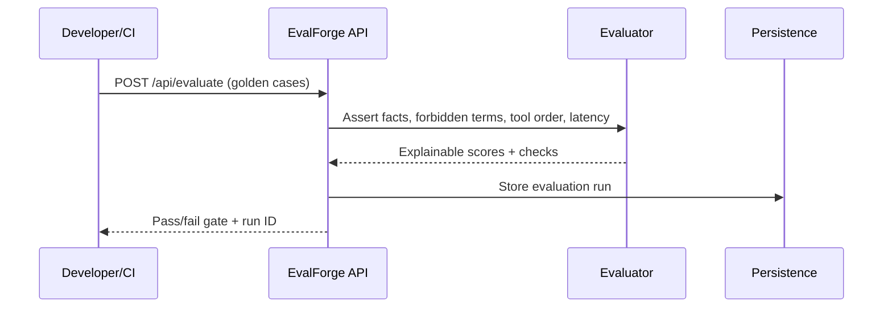
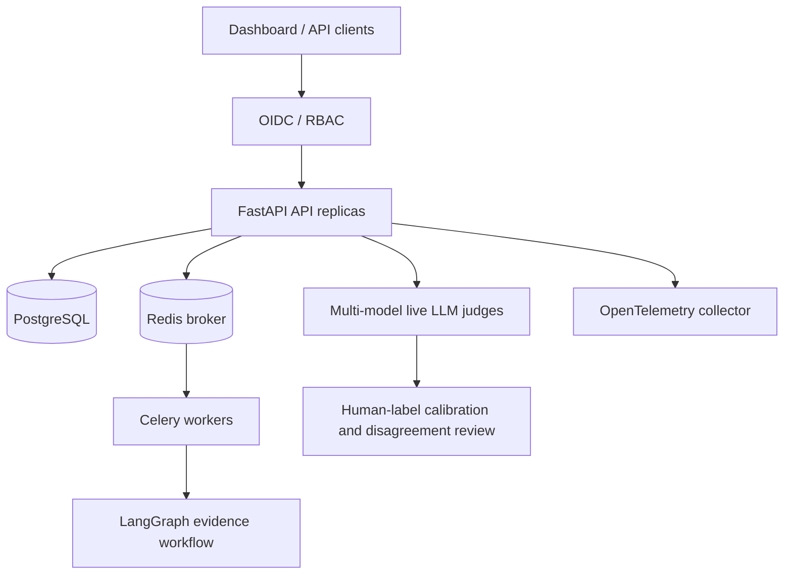

# EvalForge AI — Advanced Edition

Executable agent evaluation service with a small browser dashboard, deterministic golden tests, live optional LLM judge, pairwise comparisons, persistent run history, and basic CI.

## Architecture





## Local development

```bash
python -m venv .venv
source .venv/bin/activate
pip install -r requirements.txt
uvicorn app.main:app --reload
pytest -q
```

Open http://localhost:8000 and http://localhost:8000/docs.

## Docker

```bash
cp .env.example .env
# EDIT .env and set a secure EVALFORGE_API_KEY
docker compose --env-file .env up --build
```

## CI gate example

```bash
curl -fsS -X POST http://localhost:8000/api/evaluate \
  -H 'Content-Type: application/json' \
  -H "X-API-Key: $EVALFORGE_API_KEY" \
  -d '{"minimum_score":0.8,"cases":[{"case_id":"fact-check-1","query":"Define RAG","answer":"RAG uses retrieval and generation","required_facts":["retrieval","generation"]}]}'
```

Inspect the `passed` JSON field; HTTP 200 alone does **not** imply the gate passed.

## API

- `POST /api/evaluate`: deterministic batch checks and aggregate gate
- `POST /api/judge`: optional real LLM-as-judge via configured OpenAI-compatible provider
- `POST /api/compare`: optional LLM pairwise comparison
- `GET /api/runs`, `GET /api/runs/{id}`: persisted results
- `POST /api/graph/execute`: LangGraph evidence workflow and handoff checks
- `POST /api/judge/ensemble`: live multi-model judgments and disagreement review
- `POST /api/judge/calibrate`: compare median ensemble scores with human labels
- `POST /api/jobs/graph`, `GET /api/jobs/{id}`: development-only Celery task submission/status
- `GET /health`, `/docs`, `/`: health, API schema, dashboard

## Security & readiness

**This is an executable engineering foundation, not production-certified software.** Advanced Edition includes LangGraph workflows, handoff evaluation, multi-model judge ensembles, human-label calibration metrics, OIDC JWT validation, OpenTelemetry instrumentation, and Celery/PostgreSQL/Redis deployment templates.

Local development allows a shared API key (or no authentication when unset); production requires OIDC. Roles are checked for membership, but viewer/evaluator permissions are not differentiated by endpoint. Persisted runs are tenant-scoped; distributed job ownership remains incomplete, so job APIs are disabled in production. The dashboard currently supports API-key entry only, not an OIDC login flow.

The graph's analyst is deterministic. Calibration computes error against supplied human labels; it does not fit or persist a calibration model or prove judge reliability. Independent model names do not guarantee statistically independent judgments. Lexical checks can produce false positives. There are no database migrations, retention controls, rate limits, TLS ingress, or staged rollout controllers. `/health` reports process liveness, not database/broker readiness. See the verification report for what was actually tested.

## Advanced release (v0.2) architecture



**Important operational limitations:**
- `/api/graph/execute` runs a real LangGraph state machine and deterministic citation-based analyst, **not a live LLM-driven reasoning agent**. `/api/judge/ensemble` makes real configured provider calls.
- `/api/judge/calibrate` measures median absolute error against human labels; this is a metric, not proof of calibration on your target data distribution.
- OIDC validation expects `roles` and `tenant_id` claims. Run writes and reads are tenant-scoped. Cross-tenant job isolation and endpoint-specific role enforcement are **not complete**; do not expose this as a production multi-tenant service.
- The Kubernetes manifest is a deployment template. Use immutable image digest, migrations, secret manager, TLS, network policies, managed databases and an OTel backend before production.
- The example OTel collector uses debug output; do not ship sensitive traces to production logs.

Local advanced execution (after installing requirements):

```bash
uvicorn app.main:app --reload
curl -X POST localhost:8000/api/graph/execute -H 'Content-Type: application/json' \
  -d '{"question":"What is retrieval?","corpus":[{"id":"doc1","text":"Retrieval finds supporting context in a document collection."}]}'
```

For distributed mode, set `POSTGRES_PASSWORD`, `OIDC_ISSUER`, `OIDC_AUDIENCE`, `OIDC_JWKS_URL`, and run `docker compose -f compose.prod.yaml up --build`. Production configuration intentionally rejects unauthenticated requests.

### Verification report (2026-10-12)
- Installed all declared Python dependencies in a clean Python 3.12 virtual environment; `pip check` passed.
- **14 tests passed**, including real LangGraph execution, required-handoff failure detection, and eager/local Celery execution without a broker. Fixed the graph state annotation lookup failure uncovered by these tests.
- API smoke checks passed for dashboard serving, graph execution, persisted graph results, and OpenAPI generation.
- Python compilation and dashboard JavaScript syntax checks passed. All five YAML files parsed, including the three Kubernetes resources. YAML parsing is not deployment/schema validation.
- Docker and kubectl are unavailable in the validation environment. Container build, Compose runtime, Kubernetes schema/application, Redis-backed workers, PostgreSQL, live OIDC/JWKS, OTLP export, and real LLM-provider calls were **not verified**.
- Distributed task APIs remain disabled in `APP_ENV=production` pending tenant-scoped authorization.
- No deployment was attempted. Production readiness is not claimed.
